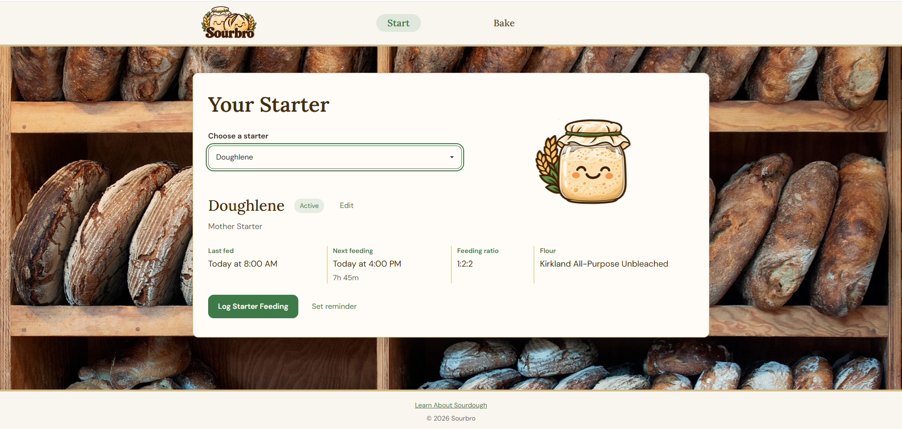
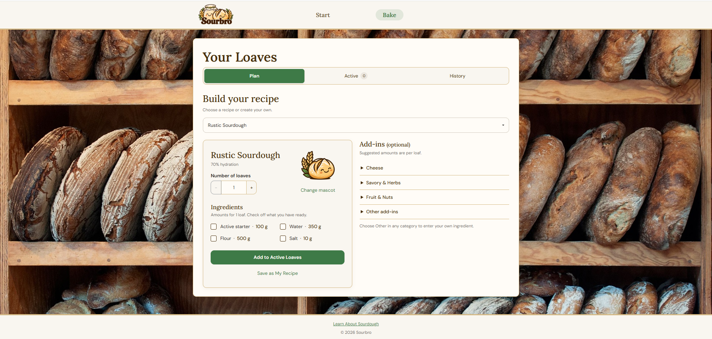
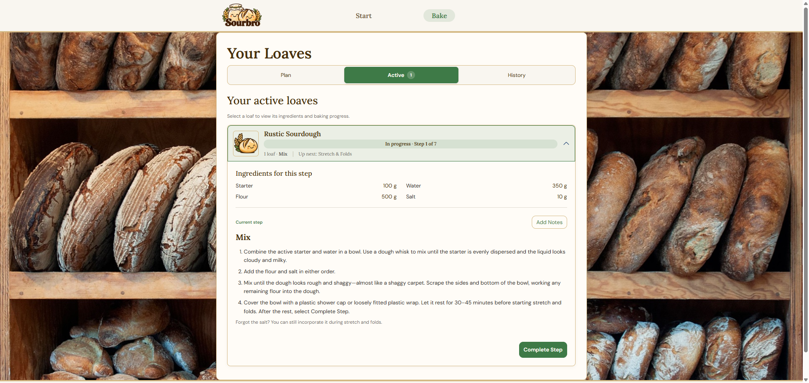
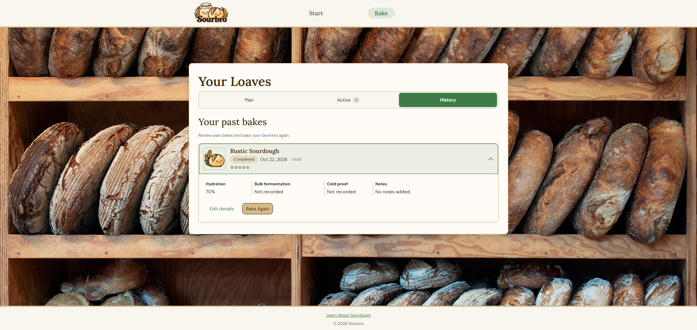
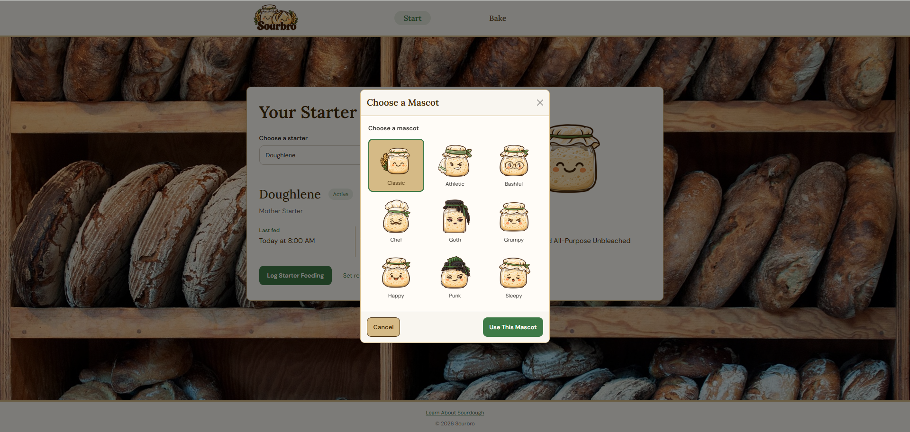
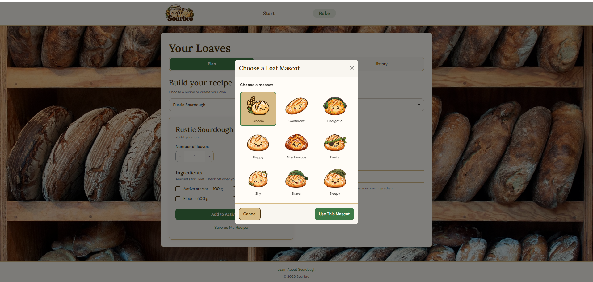
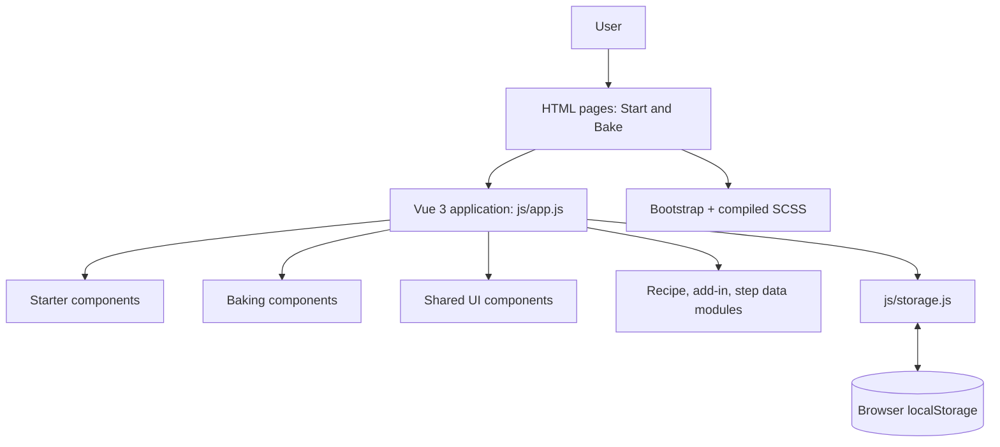
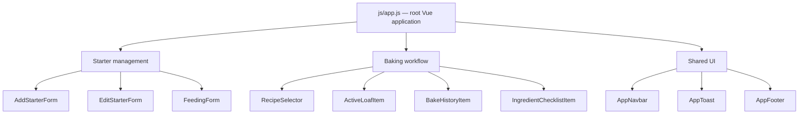
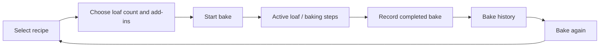

# Sourbro — Start to Bake

**Sourbro** is a browser-based sourdough companion for managing starters, planning recipes, following baking progress, and keeping a history of completed loaves. The project combines practical baking workflows with playful, customizable starter and bread mascots.

> **Portfolio project:** This repository presents the application and its technical design. Screenshots and a short walkthrough will be added here.

## Features

- **Starter management:** Add and edit starters, choose a starter, and customize its mascot.
- **Recipe planning:** Select recipes, adjust loaf quantities, customize ingredients and add-ins, and save recipes.
- **Active bakes:** Start a bake and track individual loaves through baking steps.
- **Bake history:** Record completed bakes with details such as ratings, timing, hydration, notes, and ingredients; use past bakes as a starting point for another bake.
- **Personalization:** Choose illustrated starter and loaf mascots.
- **Local persistence:** Save supported application data in the browser using `localStorage`.

## Screenshots and demo

<!-- Replace these placeholders with repository-relative image paths and a video URL. -->

## Screenshots

### Starter Dashboard


### Recipe Builder


### Active Loaves


### Bake History


### Starter Personalization


### Bread Personalization


**Video walkthrough:** _Link coming soon._

## Technology stack

| Area | Implementation |
| --- | --- |
| UI and reactivity | Vue 3 (browser ES module build; Options API) |
| Languages | JavaScript, HTML, SCSS, CSS |
| Styling | Bootstrap 5 and custom SCSS |
| Persistence | Browser `localStorage` via `js/storage.js` |
| Tooling | npm and Sass CLI |

The application uses **native JavaScript modules and HTML pages**, rather than a Vue single-file-component build system. Vue is imported from a CDN in `js/app.js`.

## Architecture



The root Vue application owns the primary state. Child components receive data through props and communicate changes through emitted events or callbacks handled by the parent. A computed `savedState` selects data to persist; a deep watcher writes that state through the storage module. On initialization, the application restores saved fields when available.

### Component organization



This is a **high-level view**, not an exhaustive component inventory. Additional forms and controls live in `js/components/bake/`, `js/components/start/`, and `js/components/shared/`.

### Baking workflow



## Project structure

```text
Sourbro_Portfolio/
├── index.html                 # Starter page
├── pages/bake.html            # Baking page
├── js/
│   ├── app.js                 # Root Vue application and state
│   ├── storage.js             # Browser persistence
│   ├── components/
│   │   ├── start/             # Starter forms
│   │   ├── bake/              # Baking workflow components
│   │   └── shared/            # Reusable UI
│   └── data/                  # Recipes, steps, add-ins, mascots
├── scss/                      # Sass source files
├── css/                       # Compiled styles
├── images/                    # UI artwork and mascots
└── package.json
```

## Run locally

1. Clone this repository and open its folder in VS Code or another editor.
2. Install dependencies if you want to edit and recompile the Sass styles:

   ```bash
   npm install
   ```

3. Serve the project root with a local HTTP server (for example, VS Code Live Server, or `python -m http.server 8000` if Python is installed).
4. Open `http://localhost:8000/` when using the Python example. Navigate to the Bake page through the app.

**Why a local server?** The app loads JavaScript ES modules; opening `index.html` directly as a `file://` URL can fail due to browser module security restrictions.

To watch and compile SCSS while editing:

```bash
npm run sass
```

**Note:** Vue and Bootstrap are referenced from external CDNs in the HTML/JavaScript, so running the application requires access to those resources. There is no backend or user account system; saved data is local to the browser and origin.

## Technical decisions

- **Centralized reactive state:** The root Vue instance coordinates data across starter and baking views.
- **Reusable UI:** Forms, selectors, active-loaf cards, and feedback components are separated into JavaScript modules.
- **Selective persistence:** A computed saved-state object determines which values are stored, rather than saving every transient UI flag.
- **Recipe reuse:** Completed bake records retain ingredient details to support repeating a bake, including customized quantities.
- **Responsive presentation:** Bootstrap layout utilities and custom Sass support different screen sizes.

## Future improvements

Potential directions include automated tests, stronger persistence and data migration handling, accessibility audits, and an optional account-based sync service. These are **future possibilities**, not features of the current version.

## Author

Developed by [Fergi3](https://github.com/Fergi3) as a web development portfolio project.

---

*Screenshots, demo video, and live deployment link will be added after review.*
